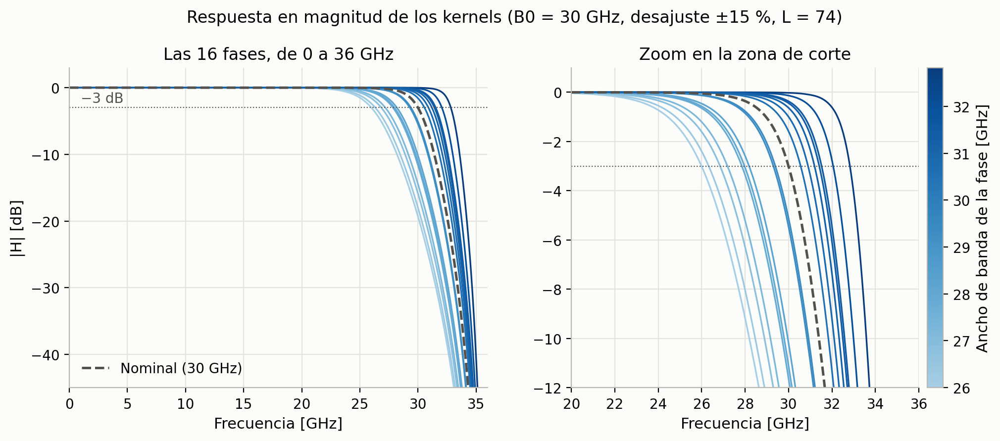
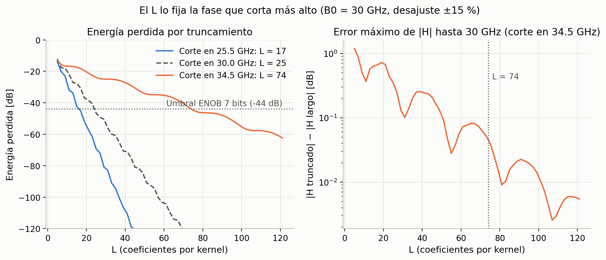
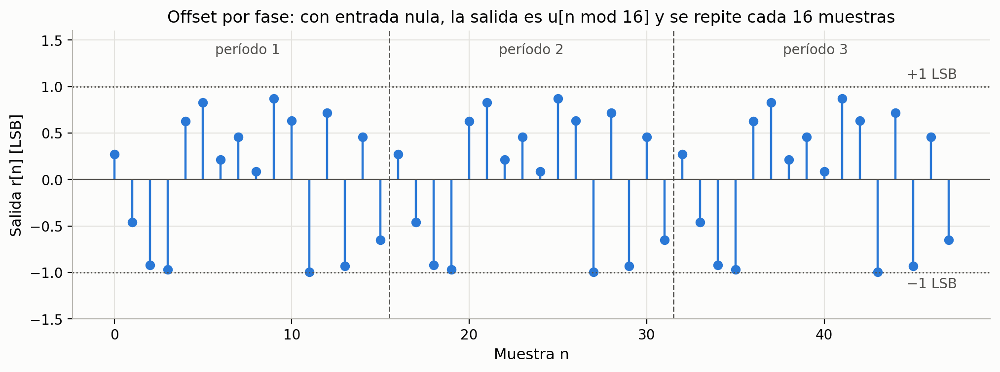
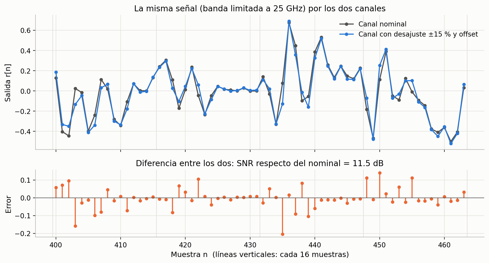
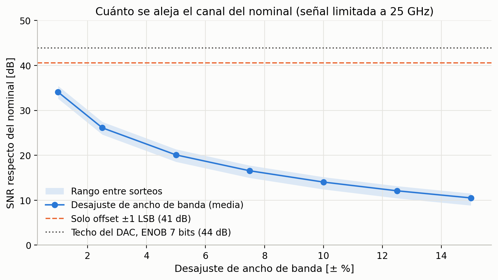

# No idealidades del camino analógico: ancho de banda y offset

Issue asociado: #4

Modelo en Python de dos no idealidades del camino analógico del FI-DAC, sobre la planta FIR periódica de 16 fases (#3): el **ancho de banda** de cada camino y el **offset** de cada sub-DAC. La ganancia y el skew, que también pide el issue, los modela Misael.

## Modelo

```
r[n] = h[p,0]·x[n] + h[p,1]·x[n-1] + ... + h[p,L-1]·x[n-L+1] + u[p],   con p = n mod 16
```

- **Ancho de banda, en los kernels `h`.** Cada fase tiene un Butterworth de orden 4 con su propio corte `B_p`, sorteado uniforme entre `B0·(1 − d)` y `B0·(1 + d)`. Se pasa a 72 GS/s con la transformación bilineal con prewarping (`scipy.signal.butter(..., fs=FS)`), así el −3 dB cae exactamente en `B_p`. El kernel de la fase es su respuesta al impulso, truncada a `L` coeficientes.
- **Offset, en el vector `u`.** No puede ir en `h`: con entrada nula, los kernels dan salida nula. Son 16 constantes, una por fase, sorteadas una sola vez entre ±1 LSB (8 bits) y fijas: no es ruido.
- **Combinación con ganancia y skew.** Si esos efectos también son kernels de 16 × `L`, se convoluciona fila por fila y se vuelve a truncar a `L`: `h_total[p] = h_bw[p] * h_otro[p]`.

Es la forma del modelo discreto de Bonetti (2026, Ec. 17): un filtro periódico más un vector de offset por fase. Los papers modelan el ancho de banda con un Butterworth y varían su corte:

| Paper | Modelo | Desajuste |
|---|---|---|
| Galetto 2021 | Butterworth de orden 6 en cada camino | ±25 % (Montecarlo) |
| Galetto 2023 | Butterworth de orden 4 | ±5 % |
| Bonetti 2026 | Butterworth de orden 4 después del ZOH, B0 = 70 GHz | [0,85; 1,15] × B0 |
| Este modelo | Butterworth de orden 4, B0 = 30 GHz | ±15 % (a definir) |

Parámetros: `fs = 72 GS/s`, `B0 = 30 GHz` (ancho de banda total del FI-DAC), `d = ±15 %`, 16 fases (72 / 4,5). El corte más alto tiene que quedar debajo de Nyquist: `B0·(1 + d) < 36 GHz`, así que `d < 20 %`.



## Largo L de los kernels

Al truncar la respuesta al impulso a `L` coeficientes se tira la cola. El criterio es que la energía de esa cola quede por debajo del ruido de un DAC con ENOB de 7 bits: `−(6,02·7 + 1,76) ≈ −44 dB` respecto de la energía total. Este umbral es una propuesta nuestra, no sale de los papers.

El `L` lo fija la fase que corta más alto: cuanto más cerca de Nyquist, más larga su respuesta. El peor caso es una fase que corta justo en `B0·(1 + d)`, así que `L` no depende del sorteo. `largo_minimo()` lo calcula:

| Desajuste | Peor corte | L |
|---|---|---|
| ±5 % | 31,5 GHz | 32 |
| ±10 % | 33 GHz | 45 |
| ±15 % | 34,5 GHz | 74 |



## Archivos

```text
modules/analog_channel/
├── python/
│   ├── fir_periodico.py                    la planta (#3)
│   └── no_idealidades.py                   ancho de banda, offset y largo L
└── simulations/
    ├── sim_no_idealidades_bw_offs.py       los tests
    └── sim_graficos_no_idealidades.py      las figuras
```

Hace falta Python 3 con NumPy, SciPy y Matplotlib.

## Cómo se usa

Desde `modules/analog_channel/python/`:

```python
import numpy as np
from no_idealidades import largo_minimo, random_butterworth, random_offset, planta_con_offset

B, orden, d = 30e9, 4, 0.15
umbral_db = -(6.02 * 7 + 1.76)                      # -43,9 dB

L = largo_minimo(B * (1 + d), orden, umbral_db)     # 74: el peor caso
h, B_fases = random_butterworth(B, orden, L, d, semilla=2)
u = random_offset(1 / 256, semilla=0)               # ±1 LSB de 8 bits, con rango 1

x = np.random.default_rng(1).uniform(-0.5, 0.5, 1000)
r = planta_con_offset(x, h, u)
```

## Tests

Desde la raíz del repositorio:

```
python modules/analog_channel/simulations/sim_no_idealidades_bw_offs.py
```

Si alguno falla, el programa se corta en ese test.

| Test | Qué verifica |
|---|---|
| O1 | Con entrada nula, la salida es `u[n mod 16]`. |
| O2 | Con y sin offset, la diferencia es `u[n mod 16]`: el offset no toca la parte lineal. |
| O3 | `u` queda dentro de ±1 LSB, y con la misma semilla sale el mismo `u`. |
| B1 | Canal identidad: la salida es igual a la entrada. |
| B2 | La suma de los taps de cada fase da 1 (ganancia en DC de un pasabajos). |
| B3 | En cada fase, `\|H(B_p)\| = −3,01 dB ± 0,05`: el corte cae en el ancho de banda sorteado. |
| B4 | Los cortes caen entre `B0·(1 − d)` y `B0·(1 + d)`, y las 16 filas son distintas. |
| B5 | Sin desajuste, la planta da lo mismo que `np.convolve`: es un filtro común. |
| B6 | Un corte por encima de Nyquist levanta `ValueError`. |
| L1 | Medición: energía perdida contra `L`, en el peor caso. |
| L2 | Medición: error de `\|H\|` hasta 30 GHz contra `L`, en el peor caso. |

## Resultados

Las figuras se generan con:

```
python modules/analog_channel/simulations/sim_graficos_no_idealidades.py
```

y se guardan en `modules/analog_channel/simulations/figuras/`, en PNG y PDF. Esa carpeta no se sube al repositorio: las imágenes de esta página son copias de esas figuras, en `docs/img/analog_channel/`.

**Offset.** Con entrada nula, la salida es un patrón de 16 valores que se repite cada 16 muestras.



**Efecto en la señal.** La misma entrada (ruido limitado a 25 GHz) pasa por el canal nominal, que tiene las 16 fases iguales y no tiene offset, y por el canal con desajuste y offset. La diferencia entre las dos salidas es lo que agregan las no idealidades.



Repitiendo esa comparación para varios desajustes (promedio de 10 sorteos):

| Caso | SNR respecto del nominal |
|---|---|
| ±5 % | 20 dB |
| ±10 % | 14 dB |
| ±15 % | 10,5 dB |
| Solo offset | 41 dB |
| Techo del DAC (ENOB 7 bits) | 44 dB |

El desajuste de ancho de banda pesa mucho más que el offset, y sin compensar el canal queda lejos de lo que el DAC puede dar. Los valores dependen de la señal de prueba: con una señal más ancha, el efecto del ancho de banda es mayor.



## Pendiente

- Definir el desajuste: con ±10 %, `L = 45`; con ±15 %, `L = 74`.
- Combinar con la ganancia y el skew.
- El estimador tiene que estimar `u` además de `h`, como el vector `v` de Bonetti (Ec. 20).

## Referencias

- A. C. Galetto, B. T. Reyes, D. A. Morero y M. R. Hueda, *Adaptive Background Compensation of Frequency Interleaved DACs With Application to Coherent Optical Transceivers*, IEEE Access, vol. 9, pp. 41821–41832, 2021.
- A. C. Galetto, J. I. Bonetti, B. T. Reyes, D. A. Morero y M. R. Hueda, *Digital Background Compensation of Analog Impairments in Jointly Frequency-Time Interleaved DACs*, IEEE Access, vol. 11, pp. 96143–96157, 2023.
- J. Bonetti, *Low-Complexity MIMO DSP for Jointly Time- and Frequency-Interleaved DACs in >100 GHz Single-Wavelength Optical Transceivers*, IEEE JETCAS, vol. 16, n.º 1, pp. 67–79, 2026.
- J. I. Bonetti, A. C. Galetto y M. R. Hueda, *Theory of Periodically Time-Variant Linear Systems*, arXiv:2305.07556, 2023.
- A. Amirkhany, A. Abbasfar, J. Savoj y M. A. Horowitz, *Time-Variant Characterization and Compensation of Wideband Circuits*, IEEE CICC, pp. 487–490, 2007.