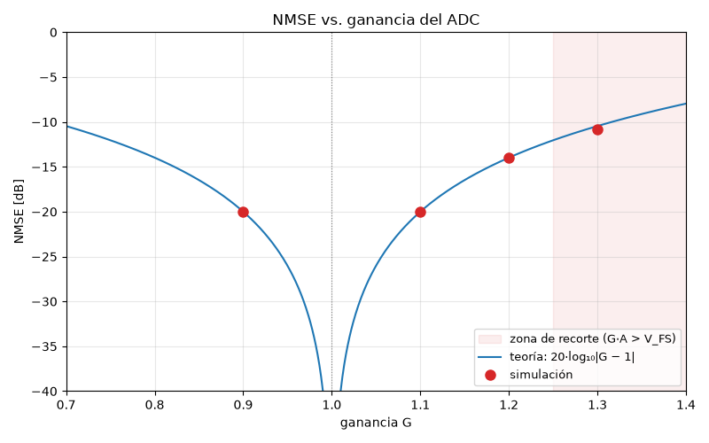
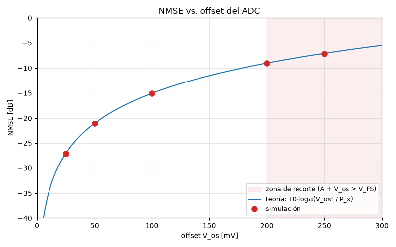
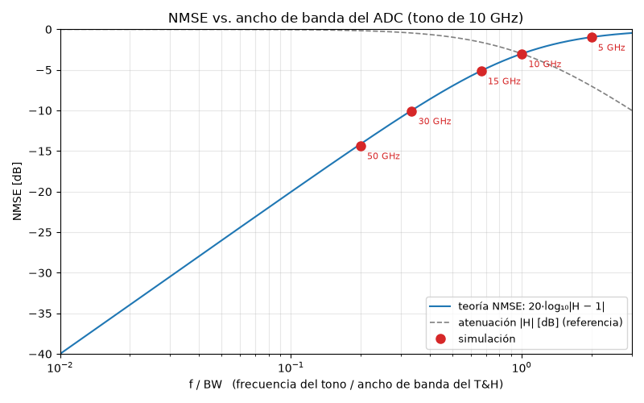

# Cal ADC — Modelo comportamental del ADC de calibración

Issue asociado: #2

Modelo en punto flotante del ADC de calibración (Cal ADC) que observa la salida del FI-DAC en el lazo de realimentación del estimador de canal. Incluye el muestreo de baja tasa propuesto por Galetto et al. y tres no idealidades del camino de observación: **ganancia**, **offset** y **ancho de banda**.

## Modelo

La cadena sigue el mismo orden que en el hardware:

```text
r(t) ─► Pasabajos RC (BW) ─► Track & Hold ─► × G ─► + V_os ─► Recorte ±V_FS ─► y_cal[m]
```

- La señal "analógica" `r(t)` se representa en una grilla fina de `L · FS = 576 GHz` (8 puntos por muestra a 72 GHz).
- El T&H dispara cada `MN + 1` muestras a `FS` (Galetto et al., ec. 14):

$$t_m = m(MN)T_s + mT_s$$

  Con `M = 320` y `N = 1.2`: un disparo cada 385 muestras, es decir `f_s,ADC ≈ 187 MHz`.
- El ancho de banda se modela como un polo RC de primer orden, discretizado con la transformación bilineal (el −3 dB cae exactamente en `BW`):

$$H(f) = \frac{1}{1 + j\,f/BW}$$

## Archivos

| Archivo | Contenido |
|---|---|
| `modules/cal_adc/python/cal_adc.py` | Modelo: `adc_cal()`, `filtro_rc()`, `respuesta_rc()` y parámetros del sistema |
| `modules/cal_adc/simulations/sim_cal_adc.py` | Compara la señal analógica con la salida del ADC y verifica amplitud, fase y offset contra la teoría |
| `modules/cal_adc/simulations/sim_nmse_barridos.py` | Barridos de NMSE variando un parámetro por vez |

## Cómo ejecutar

Requiere Python 3 con `numpy` y `matplotlib`. Desde la raíz del repositorio:

```bash
python modules/cal_adc/simulations/sim_cal_adc.py
python modules/cal_adc/simulations/sim_nmse_barridos.py
```

Los resultados se imprimen en consola y los gráficos se abren en ventanas (cerrarlas para que el script termine).

## Parámetros

### Sistema (`cal_adc.py`)

| Parámetro | Valor | Descripción |
|---|---|---|
| `FS` | 72 GHz | Frecuencia de muestreo del sistema |
| `N` | 1.2 | Muestras por símbolo (60 GBd) |
| `M` | 320 | Factor de submuestreo |
| `L` | 8 | Puntos de la grilla fina por muestra a `FS` |

### Efectos del ADC (`adc_cal()`)

| Parámetro | Valor ideal | Descripción |
|---|---|---|
| `ganancia` | 1 | Ganancia del ADC |
| `offset` | 0 V | Offset sumado a cada muestra |
| `ancho_banda` | `None` (∞) | Ancho de banda −3 dB del front-end (T&H) |
| `V_FS` | `None` | Rango de entrada ±V_FS (recorte) |

### Barridos (`sim_nmse_barridos.py`)

- Señal de prueba: tono senoidal de 10 GHz, amplitud `A = 0.8 V`, `V_FS = ±1 V`.
- 2 000 000 de puntos (≈ 3.47 µs) → ≈ 650 disparos del ADC.
- Se varía un parámetro por vez; los demás quedan en su valor ideal.
- Los tres gráficos usan el mismo eje vertical (−40 a 0 dB) para comparar la importancia de cada efecto. En rojo, la zona donde aparece recorte.
- Métrica:

$$\mathrm{NMSE} = \frac{E\{(y[m]-x(t_m))^2\}}{E\{x(t_m)^2\}}$$

## Resultados

### Verificación del modelo (`sim_cal_adc.py`)

Con `G = 1.05`, `V_os = 50 mV` y `BW = 15 GHz` sobre un tono de 10 GHz, un ajuste senoidal de las muestras recupera los tres efectos por separado:

| Magnitud | Esperado | Estimado |
|---|---|---|
| Amplitud `G·\|H\|` | 0.8740 | 0.8740 |
| Fase `∠H` | −0.5874 rad | −0.5874 rad |
| Offset | 50.00 mV | 50.00 mV |

Con los parámetros ideales, la salida coincide exactamente con la señal en los instantes de disparo (error 0).

### Ganancia

$$\mathrm{NMSE} = 20\log_{10}|G-1|$$



| G | NMSE simulado | NMSE teórico | Recortes |
|---|---|---|---|
| 0.9 | −20.00 dB | −20.00 dB | 0 |
| 1.1 | −20.00 dB | −20.00 dB | 0 |
| 1.2 | −13.98 dB | −13.98 dB | 0 |
| 1.3 | −10.80 dB | −10.46 dB | 108 |

El error es proporcional a la señal y simétrico respecto de `G = 1`. Se aparta de la teoría solo cuando `G·A > V_FS`.

### Offset

$$\mathrm{NMSE} = 10\log_{10}\frac{V_{os}^2}{P_x}$$



| V_os | NMSE simulado | NMSE teórico | Recortes |
|---|---|---|---|
| 25 mV | −27.09 dB | −27.09 dB | 0 |
| 50 mV | −21.07 dB | −21.07 dB | 0 |
| 100 mV | −15.05 dB | −15.05 dB | 0 |
| 200 mV | −9.02 dB | −9.03 dB | 18 (en el límite) |
| 250 mV | −7.20 dB | −7.09 dB | 90 |

El error es constante. El recorte es asimétrico: solo se satura el lado al que se desplaza la señal.

### Ancho de banda

$$\mathrm{NMSE} = 20\log_{10}\frac{f/BW}{\sqrt{1+(f/BW)^2}}$$



La línea gris punteada es la atenuación `|H|` en dB, como referencia.

| BW | f/BW | Atenuación | NMSE simulado | NMSE teórico |
|---|---|---|---|---|
| 50 GHz | 0.20 | −0.17 dB | −14.34 dB | −14.15 dB |
| 30 GHz | 0.33 | −0.46 dB | −10.05 dB | −10.00 dB |
| 15 GHz | 0.67 | −1.60 dB | −5.12 dB | −5.12 dB |
| 10 GHz | 1.00 | −3.01 dB | −3.01 dB | −3.01 dB |
| 5 GHz | 2.00 | −6.99 dB | −0.97 dB | −0.97 dB |

El error está dominado por el desfasaje, no por la atenuación: con BW = 50 GHz la atenuación es de solo 0.17 dB, pero el NMSE ya es −14 dB.

Nota: con `L = 8`, para `BW ≥ 100 GHz` la discretización bilineal se aparta del polo analógico (por ejemplo, −30.9 dB contra −26.0 dB en 200 GHz). Para simular anchos de banda mayores conviene aumentar `L`.

### Resumen

| Efecto | Forma del error | Impacto |
|---|---|---|
| Ganancia | Proporcional a la señal | Bajo |
| Offset | Constante | Medio (fácil de corregir restando la media) |
| Ancho de banda | Depende de la frecuencia | Alto |

## Implementado vs. analizado

**Implementado y verificado por simulación**

- Muestreo de baja tasa con disparo cada `MN + 1` muestras.
- Error de ganancia, offset, ancho de banda (polo RC) y recorte por rango de entrada.
- Comparación de NMSE simulado contra teórico para los tres efectos.

**Analizado solo de forma teórica (no simulado)**

- Efecto de estas no idealidades dentro del lazo de calibración. Como el lazo ajusta la señal para que la *medición* coincida con la referencia, se espera que:
  - la ganancia y el ancho de banda sean absorbidos por el estimador de canal en `F̂`, y que la señal transmitida quede afectada por la inversa (`1/G`, `1/H(f)`);
  - el offset no pueda ser absorbido por los filtros FIR y quede como un piso de error.
- Por esto, la respuesta del T&H debería estimarse y removerse de `F̂` (Galetto et al., sec. IV-C).

## Pendientes

- Incorporar al repositorio la simulación de jitter y la del recorrido de fases.
- Cuantización.
- Cerrar el lazo con el estimador de canal para verificar numéricamente el análisis teórico.
- Agregar `requirements.txt` (`numpy`, `matplotlib`) y `.gitignore` (`__pycache__/`), mencionados en el README pero aún no presentes.

## Referencias

- A. C. Galetto, B. T. Reyes, D. A. Morero y M. R. Hueda, "Adaptive Background Compensation of Frequency Interleaved DACs With Application to Coherent Optical Transceivers", *IEEE Access*, vol. 9, pp. 41821–41832, 2021. DOI: [10.1109/ACCESS.2021.3065269](https://doi.org/10.1109/ACCESS.2021.3065269)
- Analog Devices, "AN-737: How ADIsimADC Models an ADC".
