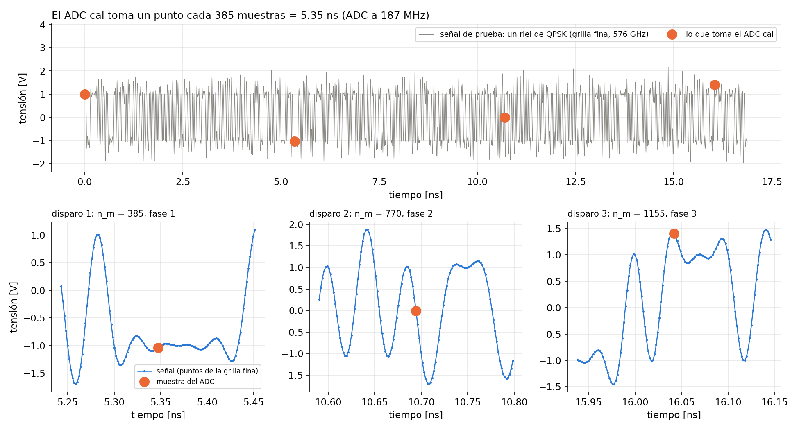
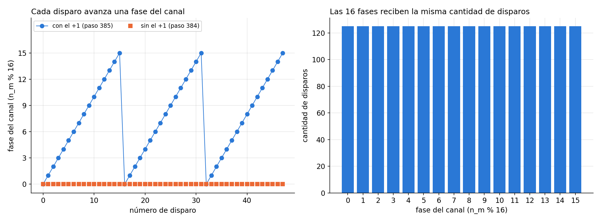
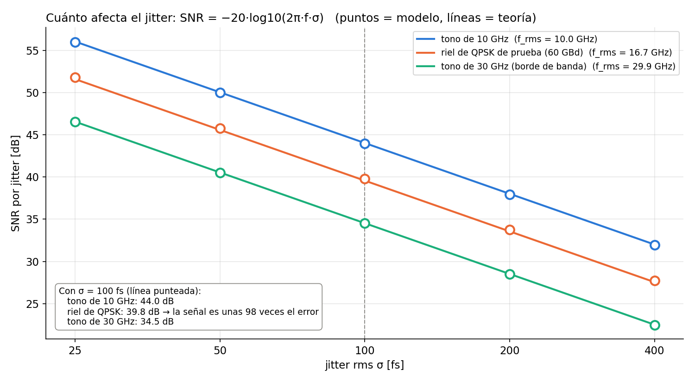

# Cal ADC — Muestreo y jitter

Issue asociado: #1

Modelo en punto flotante del muestreo de baja tasa del ADC de calibración (Cal ADC) y del jitter de muestreo. La ganancia, el offset y el ancho de banda están en el documento del issue #2.

## Modelo

- La señal "analógica" `r(t)` se representa en una grilla fina de `L · FS = 576 GHz` (8 puntos por muestra a 72 GHz).
- El ADC dispara cada `MN + 1` muestras a `FS` (Galetto et al. 2021, ec. 14):

$$t_m = m(MN)T_s + mT_s$$

  Con `M = 320` y `N = 1.2` el paso es de 385 muestras (5.35 ns, 187 MHz). Como 385 = 24·16 + 1, cada disparo cae una fase más adelante en el ciclo de 16 muestras del canal, y el ADC las recorre todas.
- El jitter corre cada disparo un tiempo $\delta_m$ al azar: gaussiano, de media cero e independiente entre disparos. Con Taylor de primer orden:

$$y_m = r(t_m) + \delta_m\, r'(t_m), \qquad \delta_m \sim \mathcal{N}(0, \sigma^2)$$

  La derivada se aproxima con la diferencia hacia adelante en la grilla fina. En la cadena del issue #2, el jitter actúa en el Track & Hold, porque corre el instante de disparo.

## Archivos

| Archivo | Contenido |
|---|---|
| `modules/cal_adc/python/adc_cal_ideal.py` | `adc_cal_ideal(r, M, L)`: instantes de disparo; devuelve `y_cal` y `n_m` (índice a 72 GHz de cada disparo) |
| `modules/cal_adc/python/adc_cal_efecto_jitter.py` | `adc_cal(x, sigma_jitter, M, L, semilla)`: el ADC con jitter |
| `modules/cal_adc/simulations/test_recorrido_fases.py` | Verifica que el ADC recorra las 16 fases con `M = 320` y `M = 640` |
| `modules/cal_adc/simulations/estudio_jitter.py` | Señal de prueba y barrido de σ: SNR del modelo contra la teoría |
| `modules/cal_adc/simulations/presentacion_jitter.py` | Genera las figuras de este documento en `docs/img/cal_adc/` |

## Cómo ejecutar

Requiere Python 3 con `numpy`, `scipy` y `matplotlib`. Desde la raíz del repositorio:

```bash
python modules/cal_adc/simulations/test_recorrido_fases.py
python modules/cal_adc/simulations/estudio_jitter.py
python modules/cal_adc/simulations/presentacion_jitter.py
```

- `test_recorrido_fases.py` imprime el chequeo y termina con un error si el ADC no recorre las 16 fases.
- `estudio_jitter.py` imprime la tabla de SNR y abre el gráfico (cerrar la ventana para que el script termine).
- `presentacion_jitter.py` guarda las figuras en `docs/img/cal_adc/`. Tarda unos 5 s y usa unos 450 MB de memoria. Para generar una sola figura: `python modules/cal_adc/simulations/presentacion_jitter.py 3`. Con `MOSTRAR = False` las guarda sin abrir ventanas.
- Los archivos de `python/` también se pueden correr solos: cada uno hace una prueba con un tono de 10 GHz.

## Parámetros

### Sistema

| Parámetro | Valor | Descripción |
|---|---|---|
| `FS` | 72 GHz | Frecuencia de muestreo del sistema |
| `N` | 1.2 | Muestras por símbolo (60 GBd) |
| `M` | 320 (también 640) | Factor de submuestreo |
| `L` | 8 | Puntos de la grilla fina por muestra a `FS` |
| `P` | 16 | Fases del canal |

### Simulaciones de jitter

| Parámetro | Valor |
|---|---|
| Jitter rms σ | 25 a 400 fs, con 100 fs de referencia |
| Disparos por medición | 2000 |
| Semillas | 0 para la señal, 1 para el jitter |
| Señales de prueba | Riel de QPSK a 60 GBd con banda limitada a 30 GHz; tonos de 10 y 30 GHz |

- Métrica: SNR, donde el error es la diferencia con la salida del ADC sin jitter. Es el NMSE del issue #2 con el signo cambiado:

$$\mathrm{SNR} = 10\log_{10}\frac{E\{x(t_m)^2\}}{E\{(y[m]-x(t_m))^2\}} = -\mathrm{NMSE}$$

## Resultados

### Recorrido de fases

Con `M = 320` (paso 385 = 24·16 + 1) y `M = 640` (paso 769 = 48·16 + 1), cada disparo avanza una fase y el ADC pasa por las 16. Sin el +1, con paso 384, cae siempre en la misma fase.





### Error de jitter

Sin jitter, `adc_cal` da exactamente lo mismo que `adc_cal_ideal`. Con jitter, el mismo δ da un error chico donde la señal es plana y uno grande donde es empinada. Con σ = 100 fs y el riel de QPSK, el error es de 10.1 mV rms, para una señal de 0.99 V rms.


### SNR por jitter

Teoría para un tono de frecuencia f (Kester, MT-007, ec. 6):

$$\mathrm{SNR} = -20\log_{10}(2\pi f \sigma)$$

Para la señal de prueba se usa su f_rms. El modelo y la teoría difieren en 0.2 dB como máximo en todo el barrido, y el SNR baja 6 dB cada vez que se duplica σ.

| Señal | f_rms | SNR simulado (σ = 100 fs) | SNR teórico | NMSE | Señal / error |
|---|---|---|---|---|---|
| Tono de 10 GHz | 10.0 GHz | 44.0 dB | 44.0 dB | −44.0 dB | 158 |
| Riel de QPSK | 16.7 GHz | 39.8 dB | 39.6 dB | −39.8 dB | 98 |
| Tono de 30 GHz | 29.9 GHz | 34.5 dB | 34.5 dB | −34.5 dB | 53 |

Barrido para el riel de QPSK:

| σ | 25 fs | 50 fs | 100 fs | 200 fs | 400 fs |
|---|---|---|---|---|---|
| SNR simulado | 51.8 dB | 45.8 dB | 39.8 dB | 33.8 dB | 27.7 dB |
| SNR teórico | 51.6 dB | 45.6 dB | 39.6 dB | 33.6 dB | 27.5 dB |



### Jitter máximo

Invirtiendo la fórmula sale el σ máximo para el SNR que se le pida al ADC cal. Es una cota, porque supone que el jitter es el único ruido.

| SNR pedido | Riel de QPSK | Tono de 30 GHz |
|---|---|---|
| 50 dB | 30 fs | 17 fs |
| 44 dB | 60 fs | 33 fs |
| 38 dB | 120 fs | 67 fs |
| 32 dB | 240 fs | 133 fs |

### Comparación con los efectos del issue #2

Con el tono de 10 GHz del issue #2 y σ = 100 fs, el jitter da NMSE = −44 dB, por debajo de la ganancia, el offset y el ancho de banda en los rangos simulados allí. A diferencia de ellos, no se puede estimar y descontar porque es aleatorio, así que se espera que quede como un piso de error.

## Implementado vs. analizado

**Implementado y verificado por simulación**

- Muestreo de baja tasa con disparo cada `MN + 1` muestras (`adc_cal_ideal.py`).
- Recorrido de las 16 fases con `M = 320` y `M = 640` (`test_recorrido_fases.py`).
- Jitter gaussiano blanco con Taylor de primer orden (`adc_cal_efecto_jitter.py`).
- SNR por jitter simulado contra teórico, con tonos y con un riel de QPSK (`estudio_jitter.py`).

**Analizado solo de forma teórica (no simulado)**

- Orden del modelo: con σ = 100 fs y el riel de QPSK, el término de segundo orden es unas 80 veces más chico que el de primer orden (0.13 mV contra 10.3 mV rms), así que alcanza con la recta tangente.
- σ máximo según el SNR que se pida (tabla de resultados).
- Efecto del jitter dentro del lazo de calibración. Como δ tiene media cero y es independiente de la señal, se espera que no sesgue la estimación, pero que ponga un piso de error que sube 6 dB cada vez que se duplica σ.

## Pendientes

- σ real del ADC cal (lo da el diseño analógico) y SNR que necesita el estimador de canal.
- Unificar este modelo con el del issue #2 en una sola función `adc_cal()`. Ese documento describe otra `adc_cal()` en `cal_adc.py`, con el mismo muestreo y las mismas constantes `FS`, `N` y `L`. En esa cadena, el jitter va en el Track & Hold.
- Cuantización.
- Usar la salida del modelo del FI-DAC en lugar de la señal de prueba.
- Cerrar el lazo con el estimador de canal para verificar el efecto del jitter.
- Jitter no blanco (por ejemplo, periódico) y retardo de apertura fijo: podrían sesgar la estimación y no están modelados.

## Referencias

- A. C. Galetto, B. T. Reyes, D. A. Morero y M. R. Hueda, "Adaptive Background Compensation of Frequency Interleaved DACs With Application to Coherent Optical Transceivers", *IEEE Access*, vol. 9, pp. 41821–41832, 2021. DOI: [10.1109/ACCESS.2021.3065269](https://doi.org/10.1109/ACCESS.2021.3065269)
- A. C. Galetto, J. I. Bonetti, B. T. Reyes, D. A. Morero y M. R. Hueda, "Digital Background Compensation of Analog Impairments in Jointly Frequency-Time Interleaved DACs", *IEEE Access*, vol. 11, pp. 96143–96157, 2023. DOI: [10.1109/ACCESS.2023.3311748](https://doi.org/10.1109/ACCESS.2023.3311748)
- L. Passetti, D. A. Morero, B. T. Reyes y M. R. Hueda, "Adaptive Digital Compensation of Analog Impairments in Frequency Interleaved ADC for Next-Generation High-Speed Communication Receivers", *IEEE Access*, vol. 11, pp. 124855–124868, 2023. DOI: [10.1109/ACCESS.2023.3330585](https://doi.org/10.1109/ACCESS.2023.3330585)
- W. Kester, "MT-007: Aperture Time, Aperture Jitter, Aperture Delay Time—Removing the Confusion", Analog Devices, Rev. A, 2008. [Enlace](https://www.analog.com/media/en/training-seminars/tutorials/MT-007.pdf)
